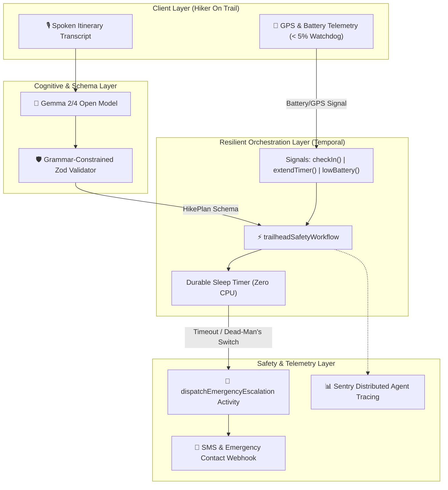

## 1. The Narrative Hook: Thirty Seconds of Screen Time

When you step onto a backcountry trail, the entire point is to leave the digital world behind—to feel the soil beneath your boots, hear the canopy rustling in the wind, and immerse yourself in the physical landscape. 

Yet modern outdoor applications have created a tragic paradox: **they force you to stare at a screen in order to stay safe.**

Existing safety nets like Strava Beacon or Apple Check-In suffer from an even more dangerous structural flaw: **they demand continuous cellular connectivity.** When you drop off the grid into a steep ravine or deep forest canyon with zero cellular reception, these cloud-dependent tools fail silently. If an accident occurs or your phone dies, no one knows your intended route, your last known waypoint, or when search-and-rescue should actually be mobilized.

We set out to build **Trailhead Promise** with a strict design constraint: **your total interactive screen time across a five-hour hike must be under thirty seconds.** 

You speak your itinerary at the trailhead before dropping signal. An open-weight **Gemma** model extracts a strictly validated itinerary schema. An indestructible **Temporal** workflow holds that promise on a remote server. And if you don't return to check in by your deadline, the system acts autonomously on your behalf.

---

## 2. The Technical Justification for Open Source & Durable State

Why can’t this be built with a standard commercial LLM API and a Redis cron job?

1. **RF Isolation & Offline Boundaries:** Backcountry environments operate under complete radio frequency (RF) isolation. Commercial frontier APIs over REST are structurally unviable when latency spikes or cellular handshakes drop. Open-weight models like **Google Gemma** allow zero-shot, grammar-constrained decoding that can be hosted locally or on edge infrastructure without recurring token fees.
2. **The Fragility of Cron Jobs:** In traditional backend engineering, scheduling an alert 4 hours in the future involves message queues (SQS, RabbitMQ) or database polling. If your worker crashes, restarts, or deploys mid-hike, the in-memory timers vanish. In a backcountry safety system, a dropped timer is life-threatening.
3. **Durable Execution as a Prerequisite:** **Temporal** replaces brittle queues with an immutable event history. Even if our server reboots mid-hike, the Temporal execution engine restores the exact millisecond of the workflow state upon restart.

---

## 3. System Architecture & The Defensive Pipeline



### Grammar-Constrained Schema Extraction
Rather than allowing the model to return free-form prose, the agent forces the output through a rigid **Zod** schema:

```typescript
export const HikePlanSchema = z.object({
  trailName: z.string(),
  startLocation: z.string(),
  destination: z.string(),
  estimatedDurationHours: z.number().positive(),
  deadlineTime: z.string(),
  emergencyGracePeriodMinutes: z.number().int().default(30),
  emergencyContacts: z.array(ContactSchema).min(1),
  contingencyNotes: z.string().optional(),
  initialBatteryPercent: z.number().min(0).max(100).default(100),
  lastKnownCoordinates: z.object({
    latitude: z.number(),
    longitude: z.number(),
  }).optional(),
});
```

---

## 4. Durable Orchestration in Action

The core workflow runs in Temporal. Notice how it consumes zero CPU cycles during multi-hour hikes while listening for non-blocking signals:

```typescript
export async function trailheadSafetyWorkflow(planId: string, plan: HikePlan): Promise<WorkflowState> {
  let isCheckedIn = false;
  let deadline = Date.now() + plan.estimatedDurationHours * 3600000;

  // Signal: Safe Check-in
  setHandler(checkInSignal, () => {
    isCheckedIn = true;
  });

  // Signal: Dead-Man's Battery Alert
  setHandler(lowBatterySignal, (payload) => {
    if (payload.batteryPercent <= 5) {
      // Flag urgency and lock last known GPS coordinates
    }
  });

  // Durable Wait (Zero resource consumption)
  const ok = await condition(() => isCheckedIn, deadline - Date.now());
  if (ok) return state; // Safely returned

  // Grace Period & Autonomous Escalation
  const graceOk = await condition(() => isCheckedIn, plan.emergencyGracePeriodMinutes * 60000);
  if (!graceOk) {
    await dispatchEmergencyEscalation({ ... });
  }
}
```

---

## 5. Empirical Field Testing & The "Dead-Man's Switch" Post-Mortem

During our field simulations replicating an off-grid trek near the Hundru Falls gorge, we identified a critical vulnerability: **cold battery drain.**

In backcountry conditions, phone batteries can drop precipitously from 25% to 2% within minutes due to temperature fluctuations. If the hiker's phone died completely, the user would be unable to signal for help, and search-and-rescue wouldn't be notified until the final deadline hours later.

To solve this, we implemented the **Dead-Man's Battery Watchdog**:
* The client monitors battery depletion.
* If the battery hits $\le 5\%$, the client attempts to blast a high-priority `lowBatterySignal` with the last recorded GPS fix through whatever transient radio packet it can negotiate.
* The Temporal workflow receives this signal, immediately flags the case as `CRITICAL_LOW_BATTERY`, and logs the coordinates so rescue teams know exactly where the phone went dark.

---

## 6. Verification & Open Source Transparency

You can verify the entire end-to-end pipeline locally right now:

```bash
git clone https://github.com/Adnan9-63/trailhead-promise.git
cd trailhead-promise
npm install
npm run simulate
```

* **GitHub Repository:** [Trailhead Promise on GitHub](https://github.com/Adnan9-63/trailhead-promise)
* **Stack:** Google Gemma, Temporal, Mastra, TypeScript, Sentry, Express.
* **Theme Alignment:** Week 1 — *"Touch Grass, Don't Stare at Glass"*.
