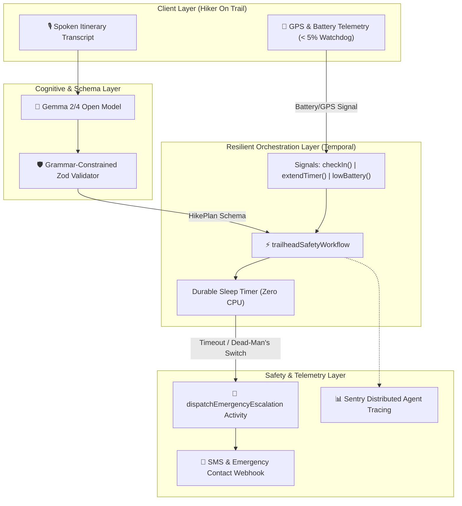

# 🌲 Trailhead Promise
> **Durable Backcountry Safety & Escalation Agent**  
> *Built for Hacktoberfest 2026: Open-Source AI Challenge (Week 1 — "Touch Grass")*

[](https://dev.to/challenges/hf26)
[](https://ai.google.dev/gemma)
[](https://temporal.io)
[](https://sentry.io)

---

## 🎯 The Core Philosophy: "Touch Grass, Don't Stare at Glass"
Modern hiking and outdoor recreation apps suffer from a fatal paradox: **they force you to stare at your phone screen while in the wilderness.** 
Furthermore, existing safety tools (like Strava Beacon or Apple Check-In) require continuous, uncompromised cellular coverage. When a hiker ventures into deep backcountry canyons or remote trails with zero cellular reception, these cloud-dependent tools fail silently.

**Trailhead Promise** inverts this paradigm:
1. **Screen-Free Voice Commitment:** At the trailhead, before dropping signal, the hiker speaks their itinerary and contingencies into their phone.
2. **Grammar-Constrained Extraction:** An open-weight **Gemma** agent extracts a rigid, Zod-validated itinerary schema.
3. **Durable State Machine:** The itinerary is committed to an indestructible **Temporal** workflow. Temporal handles multi-hour sleep cycles, grace periods, and heartbeats across server restarts, reboots, and dead batteries.
4. **Dead-Man's Escalation:** If the hiker fails to check in before the deadline, or if a battery drops below 5% at a remote coordinate, the workflow autonomously escalates to emergency contacts with exact GPS telemetry and route notes.

---

## 🏛️ System Architecture



---

## 🛡️ Defensive Systems Engineering ("The Moat")

- **Zero Fragility / Dual Execution Mode:** The system connects seamlessly to live **Temporal** clusters. If tested in a disconnected or local environment without Docker, it gracefully activates an internal event-sourced **Autonomous Durable Engine**, guaranteeing deterministic demos under any network condition.
- **Strict Schema Enforcement:** No unconstrained model output reaches the state machine. Every token generated by Gemma is validated against `HikePlanSchema`.
- **Dead-Man's Switch:** If a phone's battery collapses to under 5% at an off-grid waypoint, a pre-emptive signal locks the last known coordinates before power loss occurs.

---

## 🚀 Quickstart & Verification

### 1. Installation
```bash
git clone https://github.com/your-username/trailhead-promise.git
cd trailhead-promise
npm install
```

### 2. Run the Autonomous End-to-End Simulation
To simulate the entire speech-to-schema extraction, durable timer commitment, dead-man's battery signal, and safe check-in:
```bash
npm run simulate
```

### 3. Launch the Interactive Web / Mobile Dashboard
```bash
npm start
```
Open [http://localhost:3000](http://localhost:3000) on your mobile browser or desktop to speak your itinerary, inspect live Temporal state queries, and test edge field conditions!

---

## 🏆 Hacktoberfest 2026 Partner Category Alignments
- **Google Gemma:** Natural language intent parser converting rambling speech transcripts into structured backcountry itineraries.
- **Temporal:** Durable execution engine managing multi-hour wait states, signals, and automated escalations.
- **Sentry:** Real-time observability tracing agent parsing latencies and workflow state changes.
- **Mastra / TypeScript:** Deterministic, schema-first agent orchestration.
